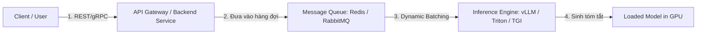

# Summarizer Serving (Production Deployment) — Source Design

> **Provenance.** Pasted by the user (in Vietnamese) on 2026-11-05 as the design for deploying the E2E-trained summarizer to production in the `ytb` repo (https://github.com/dangnguyenducanh/ytb). Reproduced verbatim below (formatting normalised; copy-paste UI lines "Hãy thận trọng khi sử dụng mã." removed) as the source of truth for `docs/superpowers/plans/2026-11-05-ytb-summarizer-serving.md`.
>
> **User directive (2026-11-05, verbatim): "https://huggingface.co/Qwen/Qwen3-0.6B use this model".** The model being served is therefore a fine-tune of **`Qwen/Qwen3-0.6B`** (a causal LM). Per section 2A below, that puts it on the "vLLM (Khuyên dùng nếu dùng LLM Causal)" path. The plan's *Decisions* section records every deviation.

---

Để đưa mô hình tóm tắt văn bản đã huấn luyện E2E (như BART, T5 hoặc một mô hình LLM dạng Causal) từ môi trường nghiên cứu ra Production (Triển khai thực tế), chúng ta cần giải quyết các bài toán về: Độ trễ (Latency) khi sinh từ (Autoregressive Generation), Tối ưu tài nguyên GPU/VRAM, và khả năng Mở rộng (Scalability).

Dưới đây là bản thiết kế kiến trúc triển khai End-to-End được tối ưu hóa theo tiêu chuẩn công nghiệp hiện nay:

## 1. Kiến trúc Tổng quan (High-Level Architecture)

Hệ thống triển khai thực tế thường tách biệt phần nhận Request và phần xử lý AI nặng để tránh nghẽn cổ chai:



1. API Gateway (BFF): Nhận văn bản cần tóm tắt từ người dùng (Web, App, Bot Zalo/Slack).
2. Message Queue: Đối với các tài liệu quá dài (như tập dữ liệu arXiv, báo cáo tài chính), thời gian tóm tắt có thể mất vài giây. Sử dụng cơ chế bất đồng bộ (Asynchronous) để người dùng không phải treo màn hình chờ.
3. Inference Engine: Trung tâm xử lý giúp tăng tốc độ chạy mô hình gấp 5-10 lần so với việc dùng code PyTorch thuần.

## 2. Các công nghệ cốt lõi phục vụ Deployment

Tùy thuộc vào kích thước của mô hình sau khi bạn huấn luyện, chúng ta chọn bộ công nghệ (Serving Stack) phù hợp:

### A. Lớp Tối ưu & Phục vụ (Inference Serving)

* vLLM (Khuyên dùng nếu dùng LLM Causal): Nổi tiếng với cơ chế PagedAttention. Nó giúp quản lý bộ nhớ KV Cache cực tốt, giảm thiểu lãng phí VRAM và tăng throughput (số lượng request xử lý cùng lúc) lên gấp nhiều lần.
* Hugging Face TGI (Text Generation Inference): Cực kỳ tối ưu cho các cấu trúc mô hình Seq2Seq như BART hay T5. Hỗ trợ sẵn các tính năng như Tensor Parallelism (nếu cần chạy trên nhiều GPU) và Dynamic Batching.
* Triton Inference Server (NVIDIA): Lựa chọn nếu hệ thống của bạn chạy đa mô hình (vừa tóm tắt, vừa nhúng Vector Embedding, vừa phân loại).

### B. Chiến lược giảm tải VRAM & Tăng tốc (Quantization & Optimization)

Khi chạy thật, bạn cần ép mô hình nhỏ lại để giảm chi phí thuê GPU:

* FP16 / BF16: Chuyển đổi mô hình từ dạng Float32 sang Float16 để tăng tốc phần cứng Tensor Cores trên GPU NVIDIA.
* Quantization (INT8 / INT4): Sử dụng các kỹ thuật như AWQ hoặc GPTQ để nén trọng số mô hình. Một mô hình lớn có thể chạy mượt mà trên các dòng GPU giá rẻ như RTX 4090 hoặc NVIDIA L4 thay vì phải dùng A100 đắt đỏ.
* Compilation (TensorRT-LLM): Biên dịch mô hình sang định dạng tối ưu riêng của NVIDIA để giảm độ trễ (Latency) xuống mức thấp nhất.

## 3. Quy trình triển khai chi tiết (Step-by-Step Pipeline)

Để đưa mô hình lên mây (Cloud), chúng ta thực hiện 4 bước đóng gói:

### Bước 1: Đóng gói Mô hình & Mã nguồn (Containerization)

Viết file `Dockerfile` sử dụng base image được tối ưu sẵn từ vLLM hoặc NVIDIA CUDA:

```dockerfile
FROM vllm/vllm-openai:latest
# Copy weights mô hình đã huấn luyện từ Giai đoạn 4 (PPO) vào container
COPY ./my_saved_ppo_model /app/model
ENV MODEL_DIR=/app/model
EXPOSE 8000
CMD ["--model", "/app/model", "--port", "8000", "--max-model-len", "2048"]
```

### Bước 2: Quản lý hàng đợi cho các tác vụ dài (Task Queue)

Vì tóm tắt văn bản là tác vụ tiêu tốn tài nguyên tính toán liên tục (Compute-bound), sử dụng Celery + Redis để xử lý ngầm:

* Client gửi bài văn → API trả về `task_id` ngay lập tức.
* Worker lấy bài văn ra đưa vào GPU để tóm tắt.
* Client dùng `task_id` để kiểm tra (Polling) hoặc nhận kết quả qua Webhook / WebSocket.

### Bước 3: Cấu hình Tự động Mở rộng (Auto-scaling với Kubernetes - K8s)

* Sử dụng KEDA (Kubernetes Event-driven Autoscaling).
* Cơ chế kích hoạt: Nếu số lượng văn bản đang nằm trong hàng đợi Redis tăng cao, hoặc lượng Request đến vLLM vượt ngưỡng, KEDA sẽ tự động ra lệnh tạo thêm các Pod GPU mới để gánh tải, và tự động tắt đi vào ban đêm để tiết kiệm chi phí.

## 4. Giám sát & Quản trị (Monitoring & LLMOps)

Khi mô hình đã chạy ổn định, chúng ta cần theo dõi sát sao hai yếu tố: Kỹ thuật và Chất lượng AI.

* Hạ tầng kỹ thuật (Prometheus + Grafana): Theo dõi mức chiếm dụng VRAM, GPU Utilization, Tốc độ sinh từ (`Tokens per Second`) và Thời gian trả kết quả từ đầu đến cuối (`Time to First Token - TTFT`).
* Giám sát chất lượng (LLM Observability): Sử dụng các công cụ như Arize, LangFuse, hoặc Phoenix.
  * Thu thập ngẫu nhiên câu tóm tắt thực tế của người dùng.
  * Đo lường độ lệch dữ liệu (Data Drift) để biết khi nào người dùng nhập các chủ đề mới lạ làm mô hình tóm tắt kém đi.
  * Theo dõi tỷ lệ lỗi bịa thông tin (Hallucination rate) để lên kế hoạch huấn luyện lại (Retraining).
