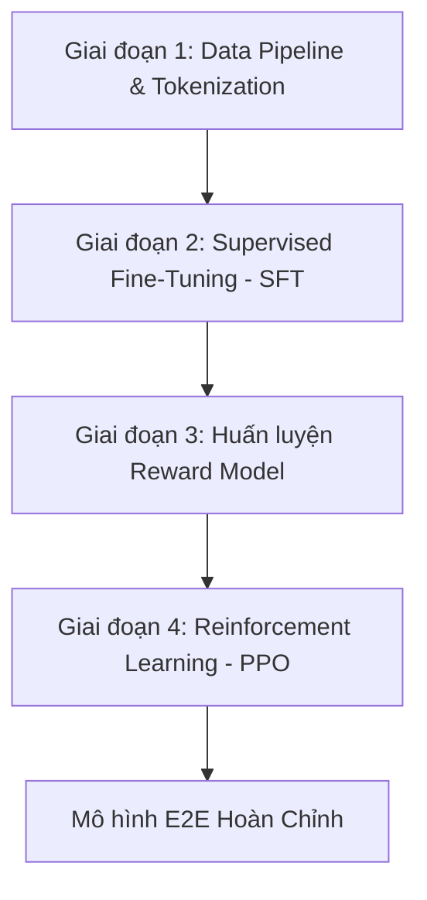

# Summarizer E2E Training Pipeline — Source Design

> **Provenance.** Pasted by the user (in Vietnamese) on 2026-11-05 as the design for an end-to-end training pipeline (data → SFT → reward → PPO) for a text-summarization model in the `ytb` repo (https://github.com/dangnguyenducanh/ytb). Reproduced verbatim below (formatting normalised; copy-paste UI lines "Hãy thận trọng khi sử dụng mã." removed) as the source of truth for `docs/superpowers/plans/2026-11-05-ytb-summarizer-training.md`.
>
> **User directive (2026-11-05, verbatim): "https://huggingface.co/Qwen/Qwen3-0.6B use this model".** The base model is therefore **`Qwen/Qwen3-0.6B`** (a causal LM). It **replaces** the "Base Model: `facebook/bart-large` hoặc `google/t5-v1_1-large`" line in Stage 2 below. The design's Stage 1 already allows causal LLMs ("BART, T5 hoặc LLM dạng Llama/Mistral"). The plan's *Decisions* section records every consequence of this change and every other deviation.

---

Để xây dựng một quy trình huấn luyện End-to-End (E2E) hoàn chỉnh cho mô hình Tóm tắt văn bản (Text Summarization) dựa trên tất cả các khái niệm chúng ta vừa thảo luận (từ Cross-Entropy, ROUGE, cho đến PPO/RLHF), dưới đây là bản thiết kế kiến trúc toàn diện từ dữ liệu thô cho đến mô hình tối ưu cuối cùng.

Quy trình E2E này được chia làm 4 giai đoạn chiến lược chuẩn công nghiệp:

### GIAI ĐOẠN 1: Data Pipeline & Tiền xử lý (Tokenization)

Mục tiêu là biến văn bản thô từ Dataset thành các Tensor số học mà mô hình (BART, T5 hoặc LLM dạng Llama/Mistral) hiểu được.

* Lựa chọn Dataset: Tùy thuộc vào mục tiêu ứng dụng của bạn:
  * Tin tức ngắn: `abisee/cnn_dailymail`
  * Tóm tắt cực gọn (1 câu): `EdinburghNLP/xsum`
  * Văn bản dài/Nghiên cứu: `ccdv/arxiv-summarization`
* Chiến lược xử lý văn bản:
  * Giới hạn độ dài (`max_input_length` = 1024 hoặc cao hơn tùy mô hình, `max_target_length` = 128/256).
  * Padding & Truncation: Đảm bảo cắt gọn chính xác để không bị tràn VRAM.
  * Label Masking: Đặt `labels` của các token đệm (`pad_token_id`) thành `-100` để PyTorch bỏ qua, không tính vào hàm Loss.

### GIAI ĐOẠN 2: Huấn luyện có giám sát (Supervised Fine-Tuning - SFT)

Đây là bước đặt nền móng. Mô hình sẽ học cấu trúc ngữ pháp và cách rút trích thông tin cốt lõi.

* Mô hình khởi tạo (Base Model): `facebook/bart-large` hoặc `google/t5-v1_1-large`. **[Superseded by user directive: `Qwen/Qwen3-0.6B`]**
* Hàm Loss chính: Label Smoothing Cross-Entropy Loss (`label_smoothing_factor=0.1`).
  * Lý do: Giúp mô hình không bị quá khớp (overfit) vào cách dùng từ cố định của tập train, tạo không gian sáng tạo cho bước RLHF tiếp theo.
* Evaluation Metrics (Đánh giá định kỳ):
  * Tính toán Loss trên tập Validation (`eval_loss`).
  * Tính toán ROUGE-1, ROUGE-2, ROUGE-Lsum (Sử dụng kỹ thuật ngắt dòng `\n` bằng thư viện `nltk.sent_tokenize` trước khi tính để tối ưu cho định dạng CNN/DailyMail).
* Đầu ra giai đoạn này: Một mô hình biết tóm tắt cơ bản, câu từ mượt mà nhưng có thể gặp lỗi lặp ý hoặc đôi khi bị "bịa" thông tin (hallucination).

### GIAI ĐOẠN 3: Xây dựng Hàm thưởng (Reward Mechanism)

Để huấn luyện học tăng cường, chúng ta cần một cơ chế để khen/chê mô hình. Có 2 cách tiếp cận:

* Cách 1: Quy tắc lập trình cứng (Rule-based / ROUGE Reward)
  * Lấy trực tiếp điểm số ROUGE-L làm điểm thưởng (Reward). Mô hình viết câu nào có ROUGE cao với đáp án sẽ được điểm cộng.
  * Ưu điểm: Cực kỳ nhanh, không tốn thêm VRAM.
* Cách 2: Huấn luyện một Reward Model (Mô hình phần thưởng đóng vai trò Critic)
  * Lấy một mô hình BERT hoặc RoBERTa, huấn luyện nó trên tập dữ liệu so sánh (ví dụ: Bản tóm tắt A tốt hơn Bản tóm tắt B).
  * Reward Model này sẽ trả về một điểm số Scalar (Ví dụ: `+1.5` cho câu hay, `-2.0` cho câu tệ).

### GIAI ĐOẠN 4: Tối ưu hóa bằng Học Tăng Cường (RLHF với PPO)

Giai đoạn nâng tầm mô hình. Đây là nơi cấu trúc "Sounds like GAN" hoạt động để loại bỏ hoàn toàn hiện tượng Exposure Bias (lỗi dây chuyền khi sinh từ).

* Cơ chế thiết lập mạng (Setup):
  1. Actor (Policy): Chính là mô hình đã được SFT ở Giai đoạn 2. Nó sẽ sinh ra câu tóm tắt ngẫu nhiên dựa trên xác suất hiện tại.
  2. Reference Model: Một bản sao "đóng băng" (frozen) của mô hình SFT để làm mốc đối chiếu.
  3. Critic (Value Network): Dự đoán điểm thưởng mà Actor sẽ nhận được.
* Hàm Loss Phối Hợp trong PPO:

  \(\text{Total\ Loss}=\text{PPO\ Policy\ Loss}-c_{1}\times \text{Value\ Loss}-c_{2}\times \text{KL\ Divergence}\)

  * PPO Policy Loss: Đẩy xác suất sinh ra các từ tốt (được điểm thưởng cao) lên.
  * Value Loss: Giúp mạng Critic dự đoán điểm số ngày càng chính xác hơn (đóng vai trò "người thầy" hợp tác).
  * KL Divergence Penalty: Phạt nặng nếu Actor thay đổi trọng số quá xa so với `Reference Model`. Điều này giữ cho mô hình không bị "nát tiếng Anh" (sinh ra các câu vô nghĩa nhưng đánh lừa được hàm ROUGE).
* Công cụ triển khai: Sử dụng thư viện TRL (Transformer Reinforcement Learning) của Hugging Face để tích hợp toàn bộ luồng PPO Actor-Critic này trong vài dòng code.

### Kết quả E2E thu được

Sau khi đi qua chuỗi E2E này, mô hình tóm tắt của bạn sẽ đạt được:

1. Độ chính xác cao: Nắm bắt từ khóa tốt nhờ SFT ban đầu.
2. Văn phong tự nhiên & Đúng độ dài: Nhờ PPO tối ưu trực tiếp trên chất lượng toàn câu thay vì đếm từ thô sơ.
3. Ít lỗi lặp từ: Thuật toán RL sẽ tự động phạt nặng các chuỗi lặp (vốn làm giảm điểm ROUGE trầm trọng).

Để bắt đầu triển khai code thực tế, bạn muốn chúng ta viết file script cấu hình cho Giai đoạn 2 (SFT với Hugging Face Trainer) trước, hay bạn muốn phác thảo đoạn mã xử lý Vòng lặp PPO (Giai đoạn 4) với thư viện TRL?
